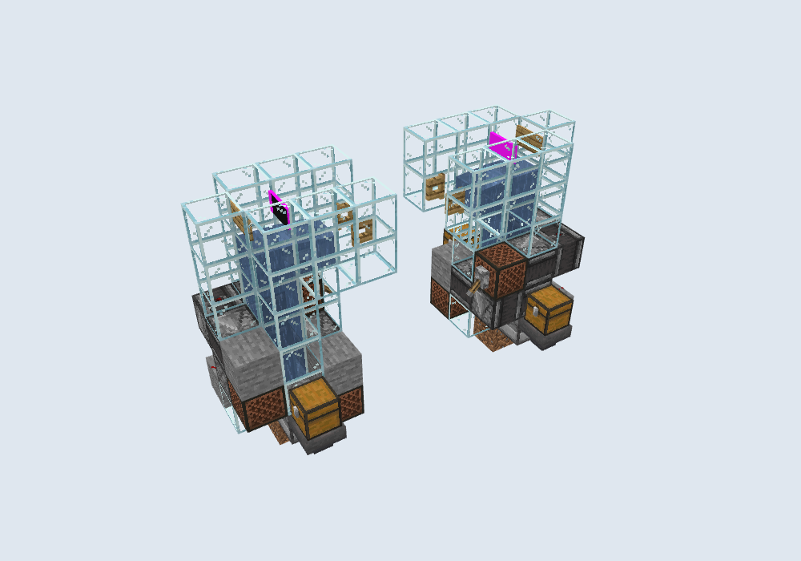

# redstack

**Minecraft farms as code – checked, modelled and tested on a real server before you build them.**

[](https://github.com/Ceiridge/redstack/actions/workflows/ci.yml)
[](LICENSE)


<p align="center">
  
</p>

```ts
import { assembly } from "@redstack/core";
import { CactusRow, Chest } from "@redstack/stdlib";

export default assembly("cactus-farm", (f) => {
  f.add(CactusRow({ cells: 16 })).to(Chest);
});
```

```
$ redstack all cactus-farm.js -o cactus-farm.litematic
cactus-farm: 20 instances, 148 blocks (Vanilla 26.3)
Yield (into storage):
  minecraft:cactus: 44.3/h
Storage:
  Chest#1: 44.3/h, full after 39.0 h
Written: cactus-farm.litematic
Viewer: cactus-farm.html

$ redstack test scenarios.js cactus-farm-16
PASS cactus-farm-16 (fabric-carpet, 1 run(s))
  measured minecraft:cactus: 44.7/h
  ok   matches-flow-model: Measurement matches the model.
  ok   no-ground-items: No items on the ground.
  ok   no-stuck-hoppers: No hoppers backed up.
  run 0: 288,001 ticks in 24.3 s, 0.084 ms server time per tick
```

You describe a farm from reusable components. redstack checks it against Minecraft's block data, predicts the yield, exports a Litematica schematic, shows it in 3D – and runs it on a headless Fabric server to measure what it really produces and how much server time it costs. When model and measurement disagree, you find out *before* spending an evening building it.

> **Status: early.** The pipeline works end to end; the component library is growing. Not an official Minecraft product; not approved by or associated with Mojang or Microsoft.

## Features

- **Components that nest** – blocks, ports and a rate model; a cell, a row, a farm and a base compose the same way. Materials are slots ("any fence"), mirrored variants come for free.
- **Transport and layout are solved, not drawn** – the router lays hopper chains, trees and splits that obey the hopper rules; a branch-and-bound layout search places free components and minimises size and hopper count.
- **Static checks** – block states against Minecraft's block table, overlaps, cells that must stay free, port alignment, redstone crosstalk.
- **Flow model** – items per hour at every port, bottlenecks, storage fill times, recipes limited by their scarcest ingredient.
- **In-game tests** – scenarios run on a Fabric + Carpet server (or in Nucleation's mc-tick engine), fast-forwarded and compared with the model: rates, lost items, backed-up hoppers, server time per tick.
- **Viewer** – textured 3D model and an isometric debug view with flows and findings.
- **Import and export** – read any `.litematic`/`.schem` (block entities included) to measure proven designs; write `.litematic`/`.schem`.
- **Economy** – a farm as a process (in, out, build cost, break-even); a mixed-integer optimizer picks the most profitable set of farms per AFK spot.
- **Standard library** – game-tested farm parts: cactus rows, kelp core, shulker loaders and unloaders, item filter, smelters, crafters for any recipe, and more ([list](docs/COMPONENTS.md)).

## What testing finds

The first cactus design passed every static check – and delivered **15 %** of the predicted yield in-game, because items fell beside the collector. Experiments found the cause, two redesigns fixed it ([story](docs/experiments/cactus.md)). Measuring other people's farms works the same way: a popular kelp farm turned out to have two dispensers that never fire, and a TNT cobblestone farm's real limit is how fast its storage takes items ([benchmarks](docs/experiments/donut-benchmarks.md), [water streams](docs/experiments/water-streams.md)).

<p align="center">
  
</p>

### The debugger

A deliberately broken farm ([source](examples/src/debugger-demo.ts)): a block next to a cactus, a hopper facing up, a chest connected to a belt end it is not at (red), and a supply chest pushing 12,000 items/h into a belt that moves 9,000/h (orange; throttled flow in red).

<p align="center">
  
</p>

```
$ redstack check debugger-demo.js
[error] reserved-cell @ (-1,2,-5): Cell (-1,2,-5) must stay free for CactusRow#1/CactusSlice#3, but Stray#1 places minecraft:stone there.
[error] port-misaligned @ (1,1,-17): Connection HopperLine#1.out → Chest#2.in: target cell (1,1,-17) is not on the input.
[error] invalid-block-state @ (3,1,-3): UpHopper#1: minecraft:hopper[facing=up] is invalid (allowed: down, north, south, west, east).
```

## Getting started

Requirements: Node.js ≥ 22.18 and pnpm 10 (`corepack enable`).

```bash
git clone https://github.com/Ceiridge/redstack.git && cd redstack
pnpm install --frozen-lockfile
pnpm test        # build + unit tests
pnpm assets      # optional: Minecraft textures for the 3D view (downloaded, checksum-verified, never committed)
pnpm example     # checks, flow model, .litematic and viewer for the example farm
```

### Commands

```bash
redstack check   <module.js>                  # static checks
redstack flow    <module.js>                  # flow model
redstack build   <module.js> -o farm.litematic [--data-version n]
redstack render  <module.js> -o farm.html     # viewer (3D if assets exist) – or .svg
redstack all     <module.js> -o farm.litematic
redstack inspect farm.litematic [-o farm.html]  # analyse any schematic: size, materials, checks, viewer
redstack test    <scenarios.js> [name...]      # in-game tests
redstack economy <module.js> [--prices p.json] # in/out per hour, build cost, break-even, profit
redstack optimize <plan.json>                  # which farms how often at which AFK spot
```

`redstack` is `node apps/cli/dist/main.js`. A module's default export is an assembly or a component. See [`examples/src`](examples/src).

### In-game tests

```bash
pnpm server setup ../redstack-server --accept-eula   # pinned, checksum-verified downloads
pnpm server start ../redstack-server
cp ../redstack-server/.env .env
pnpm test:game
```

Four in-game hours take about 25 seconds. Details: [packages/backend-fabric](packages/backend-fabric/README.md).

## Project layout

| Package | Purpose |
|---|---|
| [`core`](packages/core) | components, ports, assemblies, materials, environments, hopper router, layout search, static checks – no dependencies |
| [`flow`](packages/flow) | flow model |
| [`stdlib`](packages/stdlib) | components and environment presets |
| [`nucleation`](packages/nucleation) | adapter for [Nucleation](https://github.com/Schem-at/Nucleation): schematic I/O, block registry, 3D meshes |
| [`viz`](packages/viz) | viewer: 3D, isometric debug view, SVG |
| [`testing`](packages/testing), [`backend-fabric`](packages/backend-fabric), [`backend-mctick`](packages/backend-mctick) | scenarios, reports, model comparison; Fabric + Carpet server over RCON; Nucleation's tick engine |
| [`economy`](packages/economy), [`market-static`](packages/market-static), [`market-donut`](packages/market-donut) | processes, AFK spots, markets, plan evaluation |
| [`planning`](packages/planning) | a farm's flow model as an economic process (inputs, outputs, build cost, break-even) |
| [`apps/cli`](apps/cli) | the `redstack` command |

More: [concepts](docs/CONCEPTS.md) · [components](docs/COMPONENTS.md) · [architecture](docs/ARCHITECTURE.md) · [roadmap](docs/PLAN.md) · [experiments](docs/experiments) · [supply-chain policy](docs/SECURITY.md)

## Contributing

Everything in this repository is verified by code – unit tests, static checks or in-game scenarios – and built from composable components without duplication. Please read [AGENTS.md](AGENTS.md) (it applies to humans too) before opening a pull request.

## Acknowledgements

[Nucleation](https://github.com/Schem-at/Nucleation) for schematic I/O, block data and meshing · [Fabric](https://fabricmc.net) and [Carpet](https://github.com/gnembon/fabric-carpet) for the test server · [three.js](https://threejs.org) for the 3D view · the [Minecraft Wiki](https://minecraft.wiki) community for documenting the mechanics. Textures in the 3D view and its pictures come from Minecraft's resource pack.

## License

[MIT](LICENSE) © 2026 Ceiridge
