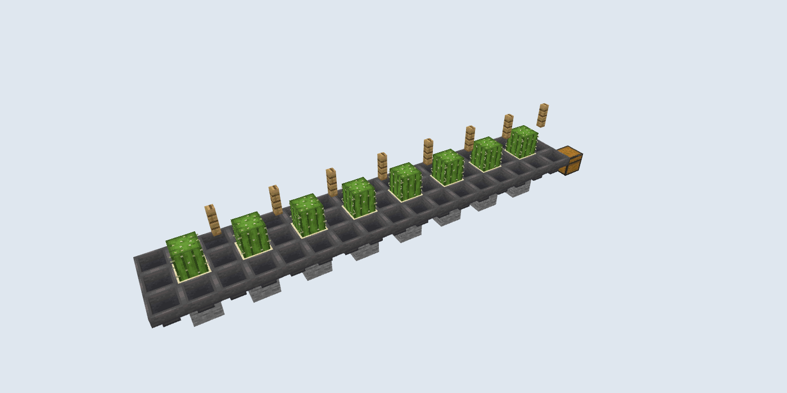

# redstack

**Minecraft farms as code – checked, modelled and tested on a real server before you build them.**

[](https://github.com/Ceiridge/redstack/actions/workflows/ci.yml)
[](LICENSE)


<p align="center">
  
</p>

```ts
import { assembly } from "@redstack/core";
import { CactusRow, Chest } from "@redstack/stdlib";

export default assembly("cactus-farm", (f) => {
  f.add(CactusRow({ cells: 16 })).to(Chest);
});
```

```
$ redstack all cactus-farm.js -o cactus-farm.litematic
cactus-farm: 20 instances, 148 blocks (Vanilla 26.3)
Yield (into storage):
  minecraft:cactus: 44.3/h
Storage:
  Chest#1: 44.3/h, full after 39.0 h
Written: cactus-farm.litematic
Viewer: cactus-farm.html

$ redstack test scenarios.js cactus-farm-16
PASS cactus-farm-16 (fabric-carpet, 1 run(s))
  measured minecraft:cactus: 44.7/h
  ok   matches-flow-model: Measurement matches the model.
  ok   no-ground-items: No items on the ground.
  ok   no-stuck-hoppers: No hoppers backed up.
  run 0: 288,001 ticks in 24.3 s, 0.084 ms server time per tick
```

You describe a farm from reusable components. redstack checks it against Minecraft's block data, predicts the yield, exports a Litematica schematic, shows it in 3D – and runs it on a headless Fabric server to measure what it really produces and how much server time it costs. When model and measurement disagree, you find out *before* spending an evening building it.

> **Status: early.** The pipeline works end to end; the component library is small (see [Components](#components)). Not an official Minecraft product; not approved by or associated with Mojang or Microsoft.

## Why it is worth it: one example

The first cactus design here passed every static check – and delivered **15 %** of the predicted yield in-game, because items fell beside the collector. Experiments located the problem, a redesign fixed it, and a reviewer's idea (share the fence between neighbours) led to a third design:

| Design | Hoppers per cactus | Length per cactus | Measured survival | Server time per tick |
|---|---|---|---|---|
| Ring | 11 | 3 blocks | 0.88 | 0.094 ms |
| **Row** | **5** | **2 blocks** | 0.84 | **0.082 ms** |

Every number comes from repeated in-game runs; the full story, including the wrong turns, is in [docs/experiments/cactus.md](docs/experiments/cactus.md).

## Concepts

**Components nest.** A component has blocks, ports and a rate model, and may contain other components. A farm is just the top-level component, so a cell, a row of cells, a farm and a whole base compose the same way.

```ts
export const CactusRow = component({ name: "CactusRow", params: { cells: 8 } }, (c, { cells }) => {
  let last = c.add(CactusRowCap);
  for (let i = 0; i < cells; i++) last = last.to(CactusSlice);  // dock slice after slice
  c.expose("out", last.port("out"));                             // the row's output is the last slice's
});
```

**Relations, not coordinates.** Blocks are placed with `above`, `inFrontOf`, `rightOf`, …; the first block is the anchor. `to()` docks the next component onto the only matching output → input and returns it, so pipelines read left to right: `supply.to(HopperLine({ length: 8 })).to(Chest)`.

**Materials, not hard-coded blocks.** Components ask for a slot such as "any fence" (`#minecraft:fences`) or "any plain solid block" (`#redstack:solid`) with a default. Build with what you have: `assembly(name, build, { materials: { cactusBreaker: "minecraft:spruce_fence" } })` – the checks verify the choice against Minecraft's block tags.

**Environments.** Rates depend on the game version and server settings (random tick speed, Spigot/Paper hopper and growth settings, simulation distance). Presets: `vanilla`, `paperDefaults`, `donutGuess` – guesses are labelled as such. Test backends refuse environments they cannot reproduce instead of measuring the wrong thing.

**Every number has an origin** (`game-mechanic`, `measured`, `estimate`) and every component a maturity (`draft` → `unverified` → `game-tested` → `server-verified`).

## What it checks and measures

| Stage | What | Speed |
|---|---|---|
| Static checks | block states and materials against Minecraft's block table, overlaps, blocks in cells that must stay free, port alignment and kinds, possible redstone crosstalk | ms |
| Flow model | items per hour at every port, bottlenecks, storage fill times, required inputs | ms |
| In-game tests | placed on a Fabric + Carpet server, fast-forwarded, measured, compared to the model; lag per tick; positions of lost items | seconds–minutes |
| Viewer | textured 3D model and an isometric debug view with flows and findings | instant |
| Export | `.litematic` / `.schem` | instant |
| Economy | profit per hour for a plan, with AFK spots, shared mob cap and market limits | ms |

### The debugger

A deliberately broken farm ([source](examples/src/debugger-demo.ts)): a block next to a cactus, a hopper facing up, a chest connected to a belt end it is not at (red), and a supply chest pushing 12,000 items/h into a belt that moves 9,000/h (orange; throttled flow in red).

<p align="center">
  
</p>

```
$ redstack check debugger-demo.js
[error] reserved-cell @ (-1,2,-5): Cell (-1,2,-5) must stay free for CactusRow#1/CactusSlice#3, but Stray#1 places minecraft:stone there.
[error] port-misaligned @ (1,1,-17): Connection HopperLine#1.out → Chest#2.in: target cell (1,1,-17) is not on the input.
[error] invalid-block-state @ (3,1,-3): UpHopper#1: minecraft:hopper[facing=up] is invalid (allowed: down, north, south, west, east).
```

## Getting started

Requirements: Node.js ≥ 22.18 and pnpm 10 (`corepack enable`).

```bash
git clone https://github.com/Ceiridge/redstack.git && cd redstack
pnpm install --frozen-lockfile
pnpm test        # build + unit tests
pnpm assets      # optional: Minecraft textures for the 3D view (downloaded, checksum-verified, never committed)
pnpm example     # checks, flow model, .litematic and viewer for the example farm
```

### Commands

```bash
redstack check   <module.js>                  # static checks
redstack flow    <module.js>                  # flow model
redstack build   <module.js> -o farm.litematic [--data-version n]
redstack render  <module.js> -o farm.html     # viewer (3D if assets exist) – or .svg
redstack all     <module.js> -o farm.litematic
redstack inspect farm.litematic [-o farm.html]  # analyse any schematic: size, materials, checks, viewer
redstack test    <scenarios.js> [name...]      # in-game tests
```

`redstack` is `node apps/cli/dist/main.js`. A module's default export is an assembly or a component. See [`examples/src`](examples/src).

### In-game tests

```bash
pnpm server setup ../redstack-server --accept-eula   # pinned, checksum-verified downloads
pnpm server start ../redstack-server
cp ../redstack-server/.env .env
pnpm test:game
```

Four in-game hours take about 25 seconds. Backends implement one interface; the Fabric + Carpet server is the first. Details: [packages/backend-fabric](packages/backend-fabric/README.md).

## Components

| Component | Status | Evidence |
|---|---|---|
| `CactusRow` (`CactusSlice`, `CactusRowCap`) | game-tested | survival per breaker, model matches a 16-cell farm |
| `CactusCell` | game-tested | the earlier ring design, kept for comparison |
| `HopperLine` | game-tested | 9,000 items/h measured = model |
| `Chest`, `SupplyChest` | game-tested | storage and test fixture in every scenario |

*game-tested* = passes on the Fabric test server with Minecraft 26.3; not yet confirmed on a production server.

## Project layout

| Package | Purpose |
|---|---|
| [`core`](packages/core) | components, ports, assemblies, materials, environments, static checks – no dependencies |
| [`flow`](packages/flow) | flow model |
| [`stdlib`](packages/stdlib) | components and environment presets |
| [`nucleation`](packages/nucleation) | adapter for [Nucleation](https://github.com/Schem-at/Nucleation): schematic I/O, block registry, 3D meshes |
| [`viz`](packages/viz) | viewer: 3D, isometric debug view, SVG |
| [`testing`](packages/testing), [`backend-fabric`](packages/backend-fabric) | scenarios, reports, model comparison; Fabric + Carpet server over RCON |
| [`economy`](packages/economy), [`market-static`](packages/market-static), [`market-donut`](packages/market-donut) | processes, AFK spots, markets, plan evaluation |
| [`apps/cli`](apps/cli) | the `redstack` command |

Design rules: [docs/ARCHITECTURE.md](docs/ARCHITECTURE.md) · Roadmap: [docs/PLAN.md](docs/PLAN.md) · Supply-chain policy: [docs/SECURITY.md](docs/SECURITY.md)

## Contributing

Everything in this repository is verified by code – unit tests, static checks or in-game scenarios – and built from composable components without duplication. Please read [AGENTS.md](AGENTS.md) (it applies to humans too) before opening a pull request.

## Acknowledgements

[Nucleation](https://github.com/Schem-at/Nucleation) for schematic I/O, block data and meshing · [Fabric](https://fabricmc.net) and [Carpet](https://github.com/gnembon/fabric-carpet) for the test server · [three.js](https://threejs.org) for the 3D view · the [Minecraft Wiki](https://minecraft.wiki) community for documenting the mechanics. Textures in the 3D view and its pictures come from Minecraft's resource pack.

## License

[MIT](LICENSE) © 2026 Ceiridge
