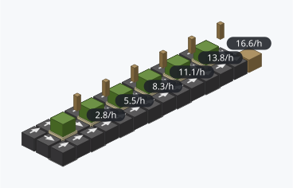
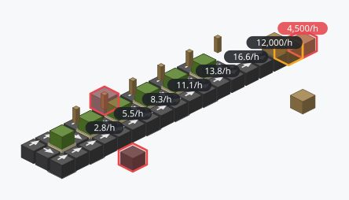

# redstack

**Minecraft farms as code – checked, modelled and tested on a real server before you build them.**

[](https://github.com/Ceiridge/redstack/actions/workflows/ci.yml)
[](LICENSE)


<p align="center">
  
</p>

You describe a farm from reusable components. redstack checks the geometry, predicts the yield, exports a Litematica schematic, and runs the design on a headless Fabric server to measure what it really produces. When model and measurement disagree, you find out *before* spending an evening building it.

```ts
const farm = new Assembly("cactus-farm");
const cells = farm.row(CactusCell, 6, steps("forward", 3));
const belt = farm.add(HopperLine, { length: 16 }).attach("in", cells[0]!.port("drops"));
for (const cell of cells.slice(1)) farm.connect(cell.port("drops"), belt.port("in"));
farm.add(Chest).attach("in", belt.port("out"));
```

No coordinates except the anchor: blocks are placed by relations (`above`, `inFrontOf`), components dock onto each other through typed ports.

> **Status: early.** The core pipeline works end to end, but the component library is small (see [below](#components)). Not an official Minecraft product; not approved by or associated with Mojang or Microsoft.

## What it does

| Stage | What you get | Speed |
|---|---|---|
| **Static checks** | overlaps, blocks in cells that must stay free, misaligned or mistyped port connections, possible redstone crosstalk | milliseconds |
| **Flow model** | items per hour at every port, bottlenecks, storage fill times, required inputs | milliseconds |
| **In-game tests** | the design placed on a real Fabric + Carpet server, fast-forwarded, measured, compared to the model | seconds to minutes |
| **Viewer** | isometric picture or interactive page with flows and findings | instant |
| **Export** | `.litematic` / `.schem` via [Nucleation](https://github.com/Schem-at/Nucleation) | instant |
| **Economy** | profit per hour for a plan, respecting AFK spots, shared mob cap and market limits | milliseconds |

### It finds real problems

The first cactus cell in this repository looked fine and passed every static check. In-game it delivered **15 %** of the predicted yield: most items fell beside the collector. A follow-up experiment confirmed the growth model, a redesign with a hopper ring was measured per breaker block (fence 85 %, glass 74 %), and the calibrated model now predicts a 16-cell farm at **44.8/h – measured: 45.0/h**. The full write-up is in [docs/experiments/cactus.md](docs/experiments/cactus.md).

### The debugger

`redstack render` shows what the checks and the flow model found. Here, a deliberately broken farm ([source](examples/src/debugger-demo.ts)): a shifted cell whose drops miss the belt, a stray block next to a cactus (both red), and a supply chest pushing 12,000 items/h into a belt that moves 9,000/h (orange, throttled flow in red).

<p align="center">
  
</p>

```
$ redstack check examples/dist/debugger-demo.js
[error] reserved-cell @ (-1,2,-3): Cell (-1,2,-3) must stay free for CactusCell#2, but StrayBlock#1 places a block there.
[error] port-misaligned @ (0,0,-9): Connection CactusCell#4.drops → HopperLine#1.in: target cell (0,0,-9) is not on the input.

$ redstack flow examples/dist/debugger-demo.js
Bottlenecks:
  HopperLine#1 in→out: 12,016.8/h in, max 9,000/h (133.5%)
```

`redstack render <module> -o farm.html` writes a standalone interactive viewer (rotate, cut away layers, toggle overlays, list of findings).

## Getting started

Requirements: Node.js ≥ 22.18 and pnpm 10 (`corepack enable`).

```bash
git clone https://github.com/Ceiridge/redstack.git
cd redstack
pnpm install --frozen-lockfile
pnpm test        # build + unit tests
pnpm example     # checks, flow model, .litematic and viewer for the example farm
```

### Commands

```bash
node apps/cli/dist/main.js check  <module.js>              # static checks
node apps/cli/dist/main.js flow   <module.js>              # flow model
node apps/cli/dist/main.js build  <module.js> -o x.litematic [--data-version n]
node apps/cli/dist/main.js render <module.js> -o x.svg|x.html [--rotation 0-3]
node apps/cli/dist/main.js all    <module.js> -o x.litematic  # all of the above
node apps/cli/dist/main.js test   <scenarios.js> [name...]    # in-game tests
```

A module's default export is an `Assembly` (or a function returning one). See [`examples/src`](examples/src).

### In-game tests

```bash
pnpm server setup ../redstack-server --accept-eula   # pinned, checksum-verified downloads
pnpm server start ../redstack-server
cp ../redstack-server/.env .env
pnpm test:game
```

```
PASS cactus-farm-16 (fabric-carpet, 1 run(s))
  measured minecraft:cactus: 45/h
  ok   matches-flow-model: Measurement matches the model.
  ok   no-ground-items: No items on the ground.
  ok   no-stuck-hoppers: No hoppers backed up.
```

Four in-game hours take about 25 seconds. Details: [packages/backend-fabric](packages/backend-fabric/README.md).

## Components

| Component | Status | Evidence |
|---|---|---|
| `HopperLine` | game-tested | 9,000 items/h measured = model |
| `Chest` | game-tested | storage in every scenario |
| `SupplyChest` | game-tested | test fixture |
| `CactusCell` | game-tested | survival measured per breaker ([experiment](docs/experiments/cactus.md)) |

*game-tested* = passes on the Fabric test server with Minecraft 26.3. Not yet confirmed on a production server; exported files have not yet been load-tested in Litematica.

## Project layout

| Package | Purpose |
|---|---|
| [`core`](packages/core) | geometry, block states, components, ports, assemblies, static checks – no dependencies |
| [`flow`](packages/flow) | flow model |
| [`stdlib`](packages/stdlib) | component library |
| [`viz`](packages/viz) | viewer data model, SVG renderer, interactive HTML |
| [`export-nucleation`](packages/export-nucleation) | schematic export (adapter) |
| [`testing`](packages/testing) | scenarios, reports, model comparison |
| [`backend-fabric`](packages/backend-fabric) | Fabric + Carpet test server over RCON |
| [`economy`](packages/economy) | processes, AFK spots, markets, plan evaluation |
| [`market-static`](packages/market-static), [`market-donut`](packages/market-donut) | price sources and server profiles |
| [`apps/cli`](apps/cli) | the `redstack` command |

Design rules: [docs/ARCHITECTURE.md](docs/ARCHITECTURE.md) · Roadmap: [docs/PLAN.md](docs/PLAN.md) · Supply-chain policy: [docs/SECURITY.md](docs/SECURITY.md)

## Roadmap

Next up: turning flow models into economic processes and an optimizer (what to build where for given prices), more tested components (water-based collection first), a 3D viewer, and later redstone logic up to CPUs. See [docs/PLAN.md](docs/PLAN.md).

## Contributing

Contributions are welcome. Everything in this repository is verified by code – unit tests, static checks, or in-game scenarios – and built from composable components. Please read [AGENTS.md](AGENTS.md) (it applies to humans too) before opening a pull request.

## Acknowledgements

[Nucleation](https://github.com/Schem-at/Nucleation) for schematic I/O · [Fabric](https://fabricmc.net) and [Carpet](https://github.com/gnembon/fabric-carpet) for the test server · the [Minecraft Wiki](https://minecraft.wiki) community for documenting the mechanics.

## License

[MIT](LICENSE) © 2026 Ceiridge
