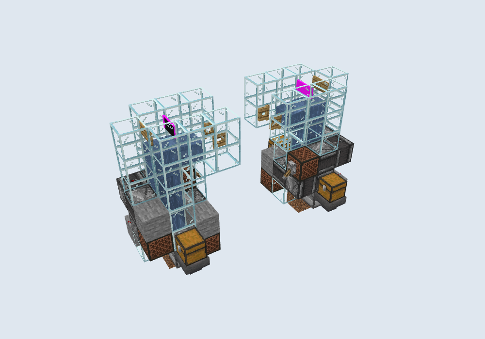
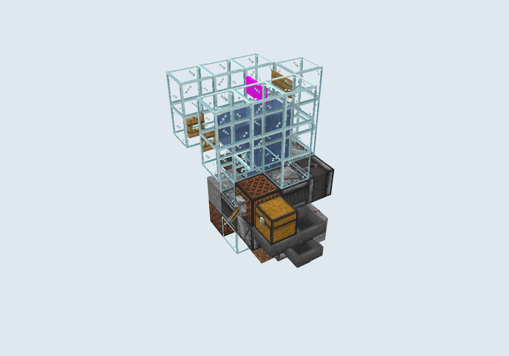

# Concepts

How designs are written in redstack. The [README](../README.md) has the overview.

**Components nest.** A component has blocks, ports and a rate model, and may contain other components. A farm is just the top-level component, so a cell, a row of cells, a farm and a whole base compose the same way.

```ts
export const CactusRow = component({ name: "CactusRow", params: { cells: 8 } }, (c, { cells }) => {
  let last = c.add(CactusRowCap);
  for (let i = 0; i < cells; i++) last = last.to(CactusSlice);  // dock slice after slice
  c.expose("out", last.port("out"));                             // the row's output is the last slice's
});
```

**Relations, not coordinates.** Blocks are placed with `above`, `inFrontOf`, `rightOf`, …; the first block is the anchor. `to()` docks the next component onto the only matching output → input and returns it, so pipelines read left to right: `supply.to(HopperLine({ length: 8 })).to(Chest)`.

**Transport is solved, not drawn.** `route(from, to)` lays the shortest hopper chain between two ports, `collect([...], to)` merges several outputs into one input with a shared hopper tree, `distribute(from, [...])` feeds several inputs through branches. The router knows the hopper rules: hoppers never carry items up, never sit under a foreign container (they would drain it) or above a foreign hopper, never where another hopper or dropper pushes in, never next to steady redstone power (dust counts only towards the sides it actually points to), and never in space a component keeps clear. Impossible routes are reported with the reason ("hoppers cannot move items up …"). The generated hoppers are a component with a rate like any other, so the flow model sees them – one hopper moves 9,000 items/h, and a supply line that starves a machine shows up as a bottleneck.

**Wires are routed too.** `wire(from, to, { minDelayTicks, avoid })` connects a signal output to the block it must power with dust on support blocks, repeaters where the signal would die out, and dust stairs for height; it ends pointing into the target or lying on it. It never joins foreign dust or connecting components, never powers anything that reacts to redstone except the target (no locked hoppers, no stray pistons, also through its support blocks), and takes in no foreign power. The delay in game ticks is in the generated `Wire` child; asked for a minimum delay it sets or adds repeaters. Wires are laid before hopper routes, which then keep away from them; `avoid` keeps cells free for routes that come later from outside. Signal ports declare intended contact, so a block on another component's signal port is not reported as crosstalk.

**Layout is searched, not drawn either.** Mark children `free()` and the layout search picks their positions and rotations (anything docked onto a free child moves with it): nothing may overlap or sit in kept-clear space, connected ports must touch, routes must be possible – and the bounding box and the hopper count are minimised (weights adjustable). It is a branch-and-bound search that calls the router for every candidate, followed by improvement moves; it says whether the result is proven optimal or the best within its budget. For two kelp cores and four supply chests it finds the layout below in about a second: both cores face one AFK player, every chest sits right above the single hopper its dispenser needs (4 hoppers – the minimum), measured at **34,500 kelp/h** for one player.

<p align="center">
  
</p>

```ts
const a = f.add(KelpBonemealCore).at([0, 0, 0]);
const b = f.add(KelpBonemealCore).free({ within: ground });          // where and which way: up to the search
const player = f.add(PlayerPickup).free({ rotations: [0] });
f.connect(a.port("kelp"), player.port("in"));
f.connect(b.port("kelp"), player.port("in"));
for (const core of [a, b]) for (const side of ["West", "East"])
  f.route(f.add(SupplyChest, supply).free({ rotations: [0] }).port("out"), core.port(`bonemeal${side}`));
```

**Mirror images for free.** `c.add(mirrored(KelpBonemealCore))` mirrors a component east ↔ west, children and block states included (stair shapes, door hinges, chest halves, rails, sign rotation). A mirrored design is marked `unverified` until tested, because redstone update order is direction-dependent; the mirrored kelp farm measures the same as the original.

**Materials, not hard-coded blocks.** Components ask for a slot such as "any fence" (`#minecraft:fences`) or "any plain solid block" (`#redstack:solid`) with a default. Build with what you have: `assembly(name, build, { materials: { cactusBreaker: "minecraft:spruce_fence" } })` – the checks verify the choice against Minecraft's block tags.

**Environments.** Rates depend on the game version and server settings (random tick speed, Spigot/Paper hopper and growth settings, simulation distance). Presets: `vanilla`, `paperDefaults`, `donutGuess` – guesses are labelled as such. Test backends refuse environments they cannot reproduce instead of measuring the wrong thing.

**Every number has an origin** (`game-mechanic`, `measured`, `estimate`) and every component a maturity (`draft` → `unverified` → `game-tested` → `server-verified`).


## Economy

With `--prices` (a JSON price list, see [`market-static`](packages/market-static/src/index.ts); [`examples/prices/example.json`](examples/prices/example.json) has invented numbers) it adds revenue, purchases, profit per hour and payback time.

`redstack optimize` takes several farms, AFK spots, accounts and a price list ([example](examples/plan.json)) and solves a mixed-integer program for the most profitable plan: how many of each farm at which spot, respecting the number of accounts, the mob cap and load budget per spot, how much the market absorbs, and build cost spread over a horizon. Farms can feed each other (a bone meal farm supplying kelp cores). The solver is built in and checked against brute force; the plan is re-rated by the same evaluation used for hand-made plans.


## Learning from real farms

redstack reads existing schematics, so proven designs can be measured instead of trusted. The *Small Fast Kelp Farm* from donut.build turned out to be a 1 : 1 bone meal → kelp converter (18,000/h) in which two of its four dispensers never fire successfully. The rebuild keeps its redstone core, drops the idle dispensers and lets the router lay the supply hoppers – **6 hoppers and 2 chests instead of 9 hoppers and 6 chests**, same measured output. Details, including a TNT-duper cobblestone farm at ≈ 208,000/h: [experiments/donut-benchmarks.md](experiments/donut-benchmarks.md).

That TNT farm, with its storage hall replaced by shulker loaders that the layout search places and the router connects, packs 103,000 cobblestone/h into boxes with 12 loaders (model 108,000) – and shows the real limit: one `ShulkerLoader` takes 9,000/h, so the full output would need about 23 (or 12 of the two-hopper `FastShulkerLoader`).

<p align="center">
  
</p>

```ts
export default assembly("kelp-farm", (f) => {
  const core = f.add(KelpBonemealCore).at([0, 0, 0]);
  const west = f.add(SupplyChest, { item: "minecraft:bone_meal" }).at([-1, 3, 1]);
  const east = f.add(SupplyChest, { item: "minecraft:bone_meal" }).at([3, 3, 3]);
  f.route(west.port("out"), core.port("bonemealWest"));   // hoppers placed and oriented by the router
  f.route(east.port("out"), core.port("bonemealEast"));
  f.connect(core.port("kelp"), f.add(PlayerPickup).at([1, 1, 5]).port("in"));
});
```

